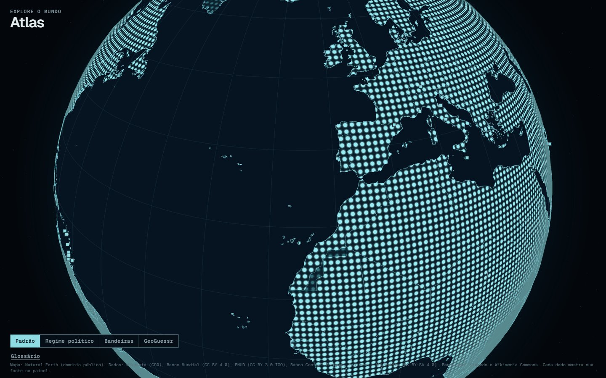
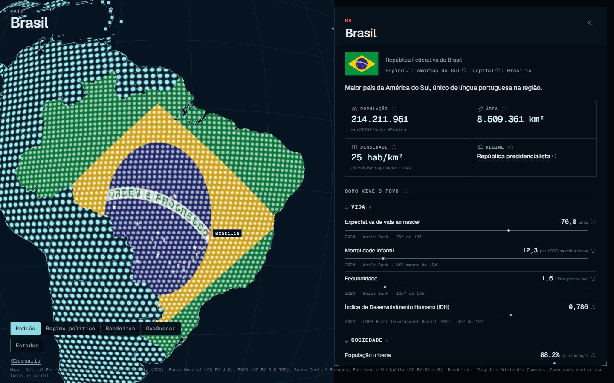
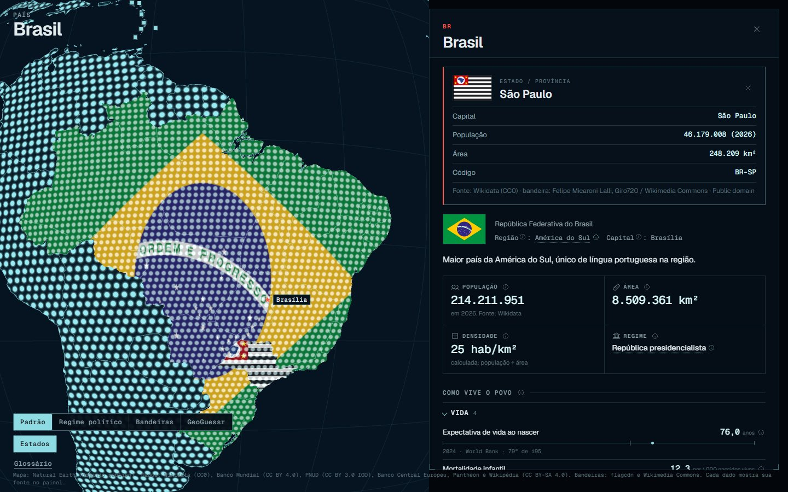
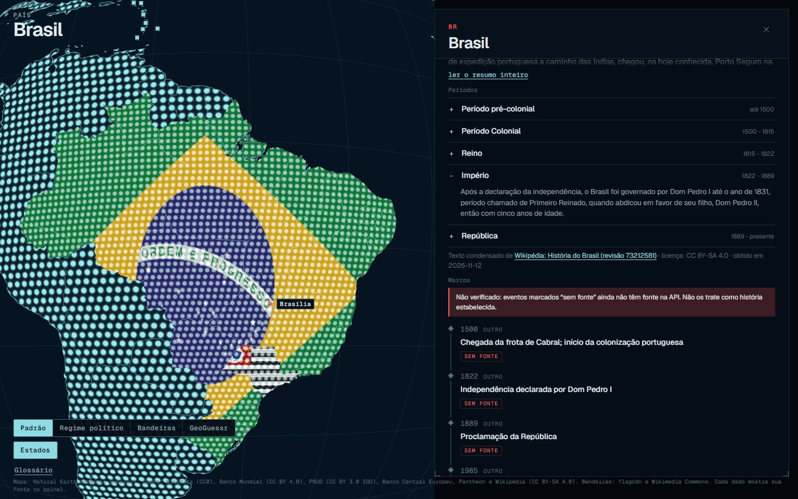
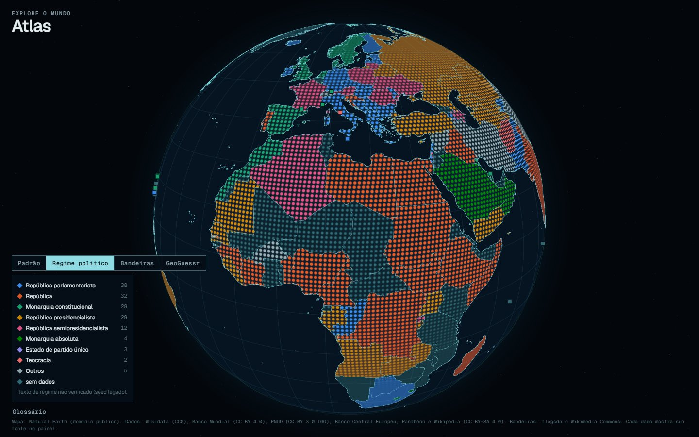
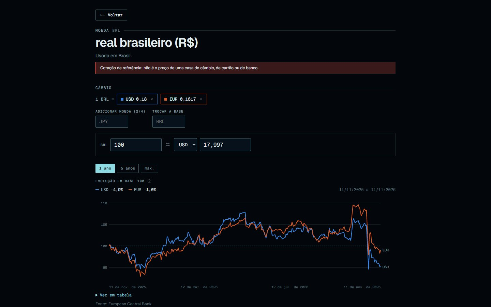
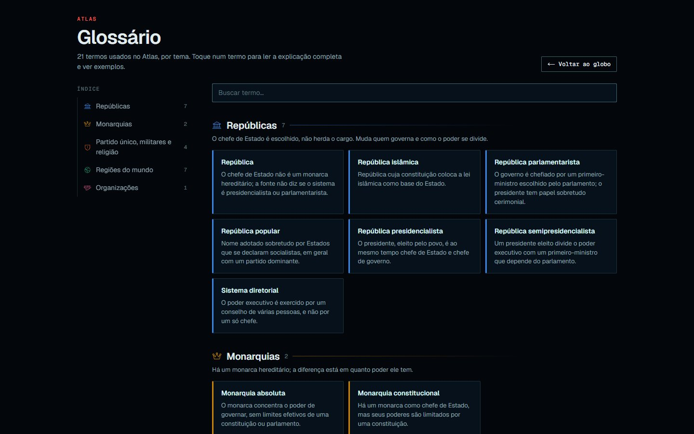
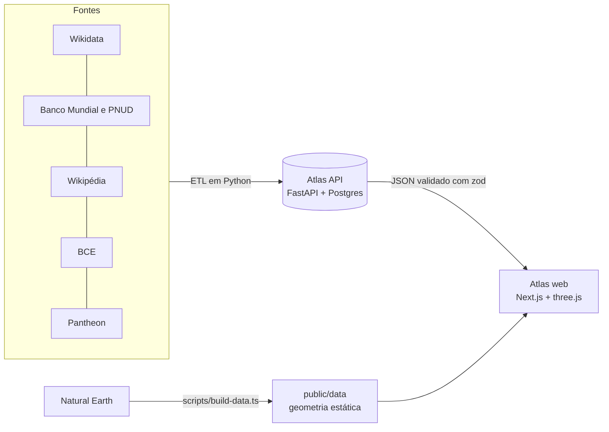

# Atlas

**Um globo 3D para explorar os países do mundo: política, história, economia e como vive o povo, com a fonte de cada dado à vista.**

[**Abrir o Atlas**](https://atlas-web-ruddy.vercel.app) · [Documentação da API](https://atlas-api.fastapicloud.dev/docs) · [Repositório da API](https://github.com/DaviAlcanfor/atlas-api)



## O que dá para fazer

| | |
|---|---|
|  | **Painel do país.** Clique em qualquer um dos 197 países: a bandeira cobre o território e o painel abre com população, área, densidade, regime político, capital, idiomas, moedas, organizações, governantes atuais e anteriores, pessoas importantes e os indicadores de "como vive o povo" (expectativa de vida, IDH, renda, escolaridade...), cada um com a posição do país no ranking mundial. |
|  | **Estados e províncias.** O botão *Estados* libera as subdivisões do país: passe o mouse para ver o nome e a bandeira, clique para cobrir o estado com a bandeira dele e ver capital, população, área e código ISO 3166-2. São 3.754 subdivisões em 240 países. |
|  | **História.** Resumo em texto corrido e períodos expansíveis com datas (Colônia, Reino, Império, República...), condensados do artigo "História de X" da Wikipédia, com link para a revisão exata usada. Abaixo, os marcos curados. |
|  | **Camadas do mapa.** *Regime político* colore os países por forma de governo (paleta categórica testada para daltonismo); *Bandeiras* pinta o mundo inteiro com as bandeiras; *GeoGuessr* destaca onde há Street View. |
|  | **Moedas e câmbio.** Cada moeda tem uma página com conversor, até quatro moedas comparadas em base 100 e histórico de 1 ano, 5 anos ou desde 1999 (Banco Central Europeu). |
|  | **Glossário.** Todo termo do painel tem um ⓘ com a explicação. O glossário reúne os verbetes por tema (repúblicas, monarquias, regimes de exceção, regiões, organizações), com índice e exemplos clicáveis que levam o globo até o país. |

Também tem pistas para o GeoGuessr (lado da direção, DDI, domínio, placas, alfabeto, cobertura do Street View, hemisfério) e link para o guia Plonk It de cada país.

## Princípios

- **Nenhum dado inventado.** Dado ausente aparece como "sem dados". Texto não verificado ganha um aviso.
- **Fonte em todo bloco.** Cada número mostra de onde veio, com ano e licença.
- **Um lugar para os fatos.** O site fala só com a [Atlas API](https://github.com/DaviAlcanfor/atlas-api). Não chama Wikidata, World Bank ou outras fontes no navegador e não guarda chaves.

## Como funciona



- **Globo:** `react-globe.gl` (three.js). A terra é uma matriz de pontos desenhada por shader (`src/lib/dotMaterial.ts`), com um material por estado visual, e não por país. As bordas são dois `LineSegments` únicos. O hover usa ponto-em-polígono com `d3-geo` em vez de raycasting na malha, que custava cerca de 15 ms por quadro.
- **Páginas:** Next.js App Router. `/pais/[iso2]` é pré-gerada para os 197 países (SSG + ISR de 1 h, com metadados e Open Graph por país). O globo vive no layout raiz e nunca é recriado entre rotas.
- **Contrato com a API:** os tipos são gerados do OpenAPI da API (`src/api/openapi.gen.ts`), e cada schema zod é comparado a eles em tempo de compilação (`src/api/contract-check.ts`). Se a API mudar um campo, o `tsc` quebra.
- **Modo offline:** sem `NEXT_PUBLIC_API_URL`, o app usa fixtures em memória (`src/api/mocks/`), com as mesmas validações, e mostra o selo "dados de teste".

## Stack

TypeScript (strict) · Next.js 16 (App Router) · React 19 · react-globe.gl / three.js · d3-geo · zod · Vitest + Testing Library · Playwright

## Rodando localmente

Requer Node 20.9 ou mais novo (mínimo do Next.js 16).

```bash
npm install
npm run dev            # http://localhost:5173
```

Por padrão o app usa os dados de teste. Para usar a API real, crie `.env.local` com:

```bash
NEXT_PUBLIC_API_URL=https://atlas-api.fastapicloud.dev
```

| Comando | O que faz |
|---|---|
| `npm run dev` / `npm run build` / `npm start` | desenvolvimento, build de produção (inclui typecheck), servidor de produção |
| `npm test` | testes (Vitest) |
| `npm run typecheck` | `tsc --noEmit` |
| `npm run api:types` | regenera os tipos a partir do OpenAPI da API (`-- --check` falha se estiverem desatualizados) |
| `npm run smoke [-- <url>]` | teste de fumaça do site publicado: API respondendo, sem erros no console |
| `npm run shot -- <pasta>` | screenshots e medição de quadros por segundo ao arrastar |
| `npm run readme-shots [-- <url>]` | regenera as imagens deste README |
| `npm run data` | regenera a geometria (`public/data/`) a partir do Natural Earth |

> **Windows:** se o caminho do projeto tiver `&`, o `npx` falha. Chame as ferramentas direto (`node node_modules/next/dist/bin/next`). O Vitest precisa rodar a partir de um caminho sem `&` (ex.: uma junction).

## Estrutura

```
app/              rotas: / (globo), /pais/[iso2], /moeda/[code], /glossario; ícone do site
src/
  Shell.tsx       globo, leitor do topo, camadas e rodapé, montados uma vez no layout
  components/     Globe, CountryPanel, SubdivisionCard, HistorySummary, Profile, CurrencyPage...
  api/            cliente, schemas zod, tipos gerados do OpenAPI, checagem de contrato, mocks
  lib/            tokens de design (palette.ts), shaders, regimes, Street View, câmbio, perfil
public/data/      geometria: países, fronteiras e costas, estados por país (admin1/)
scripts/          ETL da geometria, tipos da API, screenshots, smoke test
specs/            uma spec por funcionalidade (mesmo número no repositório da API) e o PLAN.md
contract/         contrato da API (cópia idêntica à do repositório da API)
```

## Como o projeto é tocado

Toda funcionalidade começa como uma spec em [`specs/`](specs/README.md), que passa por rascunho, aprovação, implementação e conclusão. A API é feita antes do front, e campo novo só entra depois de virar contrato. O roteiro e o histórico de decisões estão em [`specs/PLAN.md`](specs/PLAN.md). As convenções de código estão no [`AGENTS.md`](AGENTS.md).

## Limitações conhecidas

- **Viagem no tempo** (fronteiras históricas com um controle deslizante de anos) está planejada ([spec 012](specs/012-time-travel.md)) e ainda não existe.
- **Regime político:** o texto vem de um seed antigo ainda não verificado, e a legenda avisa isso.
- **Fronteiras disputadas** (Kosovo, Taiwan, Crimeia) seguem o Natural Earth. Territórios sem código ISO (Somalilândia, Chipre do Norte) não têm dados.
- **No celular,** o painel vira uma folha inferior e o rodapé de atribuições fica oculto.

## Dados e licenças

| Fonte | Uso | Licença |
|---|---|---|
| [Natural Earth](https://www.naturalearthdata.com/) | países, fronteiras, estados | domínio público |
| [Wikidata](https://www.wikidata.org/) | fatos dos países e estados, governantes, idiomas | CC0 |
| [Banco Mundial](https://data.worldbank.org/) | indicadores sociais e econômicos | CC BY 4.0 |
| [PNUD](https://hdr.undp.org/) | IDH, anos de estudo | CC BY 3.0 IGO |
| [Banco Central Europeu](https://www.ecb.europa.eu/) | câmbio | reuso livre com citação |
| [Wikipédia](https://pt.wikipedia.org/) | resumos de história, cobertura do Street View | CC BY-SA 4.0 |
| [Pantheon](https://pantheon.world/) | pessoas importantes | CC BY-SA 4.0 |
| [flagcdn](https://flagpedia.net/) · [Wikimedia Commons](https://commons.wikimedia.org/) | bandeiras de países · bandeiras de estados | domínio público · licença por arquivo, mostrada junto da imagem |

O código está sob a licença [MIT](LICENSE).
